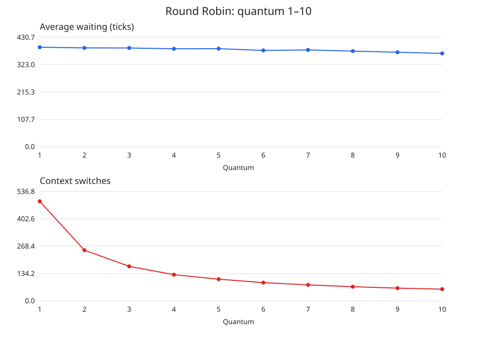

# Практическая работа № 5 — симулятор планирования CPU

Вариант Б. Реализованы FCFS, невытесняющий SJF, SRTF, вытесняющее
приоритетное планирование и Round Robin. Функция
`simulate(processes, algorithm, **params)` возвращает список интервалов
`(start, end, pid)`. Границы интервалов: `[start, end)`.

## Запуск

Требуется Python 3.8 или новее. Сторонние пакеты не нужны.
Все команды выполняются из каталога `pr5`.

```bash
python3 sched.py --algo rr --quantum 3 set1.txt
python3 sched.py --compare --quantum 3 set2.txt
python3 sched.py --sweep set2.txt
python3 make_aging_set.py
python3 sched.py --algo priority --aging 2 set_aging.txt
python3 test_sched.py
python3 generate_report.py
```

Последняя команда обновляет этот отчёт и результаты в `results/`.

## Данные и соглашения

Формат строки: `PID arrival burst priority`. Допускаются пустые строки
и комментарии после `#`. Значения времени — целые такты.
Меньшее число priority означает более высокий приоритет; отрицательные
значения допустимы. set1 содержит процессы из условия, приоритеты
3, 1, 4, 2 добавлены самостоятельно, поскольку в контрольном примере
они не указаны. На FCFS, SJF, SRTF и RR они не влияют.

set2 и set3 — собственные воспроизводимые наборы: исходные файлы преподавателя
не были предоставлены. set2: 20 процессов с длинными burst 16–33 такта.
set3: 20 процессов, один burst 80 тактов и 19 burst по 1–3 такта.
Если преподаватель выдаёт готовые файлы, следует заменить эти наборы и
повторить `python3 generate_report.py`; выводы и числа относятся к данным
в этом репозитории.

При равенстве ключей учитываются arrival и порядок строк файла.
В вытесняющих алгоритмах текущий процесс сохраняет CPU при равенстве
оставшегося времени или эффективного приоритета. Новые поступления
проверяются каждый такт. В RR все процессы с arrival <= конца кванта
добавляются в очередь раньше возвращаемого процесса.

Стоимость переключения в симуляции равна нулю. Число переключений —
переходы между разными PID без промежуточного IDLE; первый запуск,
переходы через IDLE и повторные кванты одного PID не считаются.

## Метрики

- Оборот: `completion - arrival`.
- Ожидание: `completion - arrival - burst`.
- Отклик: `first_start - arrival`.
- Загрузка CPU: `sum(burst) / last_completion * 100%`.

Загрузка измеряется на интервале от времени 0 до последнего завершения,
включая начальный простой. Средние считаются по всем процессам.

## Проверка set1

SRTF: `0–1 P1 | 1–5 P2 | 5–10 P4 | 10–17 P1 | 17–26 P3`.
Ожидания в порядке P1…P4: 9, 0, 15, 2; среднее 6,50.
Обороты: 17, 4, 24, 7; среднее 13,00.

RR, q=3: `0–3 P1 | 3–6 P2 | 6–9 P3 | 9–12 P4 | 12–15 P1 |
15–16 P2 | 16–19 P3 | 19–21 P4 | 21–23 P1 | 23–26 P3`.
Ожидания: 15, 11, 15, 13; среднее 13,50.
Обороты: 23, 15, 24, 18; среднее 20,00.

**В условии ошибочен эталон FCFS.** Для данных P1=(0,8), P2=(1,4),
P3=(2,9), P4=(3,5) диаграмма FCFS:
`0–8 P1 | 8–12 P2 | 12–21 P3 | 21–26 P4`.
Ожидания: 0, 7, 10, 18. Среднее `(0+7+10+18)/4 = 8,75`.
Обороты: 8, 11, 19, 23. Среднее `61/4 = 15,25`.
Указанные 9,25 и 15,75 не соответствуют этому набору.
Код использует стандартный FCFS, без подгонки под ошибочный эталон.

## Сравнение алгоритмов

RR использует q=3, Priority — без aging. Время измеряется в тактах.

### set1.txt

| Алгоритм | Ожидание | Оборот | Отклик | CPU, % | Переключения |
|---|---:|---:|---:|---:|---:|
| FCFS | 8.75 | 15.25 | 8.75 | 100.00 | 3 |
| SJF | 7.75 | 14.25 | 7.75 | 100.00 | 3 |
| SRTF | 6.50 | 13.00 | 4.25 | 100.00 | 4 |
| PRIORITY | 6.50 | 13.00 | 4.25 | 100.00 | 4 |
| RR | 13.50 | 20.00 | 3.00 | 100.00 | 9 |

### set2.txt

| Алгоритм | Ожидание | Оборот | Отклик | CPU, % | Переключения |
|---|---:|---:|---:|---:|---:|
| FCFS | 218.40 | 242.95 | 218.40 | 100.00 | 19 |
| SJF | 197.15 | 221.70 | 197.15 | 100.00 | 19 |
| SRTF | 195.90 | 220.45 | 189.25 | 100.00 | 20 |
| PRIORITY | 220.75 | 245.30 | 210.90 | 100.00 | 20 |
| RR | 388.55 | 413.10 | 26.65 | 100.00 | 169 |

### set3.txt

| Алгоритм | Ожидание | Оборот | Отклик | CPU, % | Переключения |
|---|---:|---:|---:|---:|---:|
| FCFS | 83.00 | 88.85 | 83.00 | 100.00 | 19 |
| SJF | 79.10 | 84.95 | 79.10 | 100.00 | 19 |
| SRTF | 6.95 | 12.80 | 5.10 | 100.00 | 20 |
| PRIORITY | 10.65 | 16.50 | 7.80 | 100.00 | 22 |
| RR | 15.15 | 21.00 | 13.30 | 100.00 | 22 |

### Вывод для set3

Лучший из сравниваемых по среднему ожиданию и обороту — SRTF:
6,95 и 12,80. Он вытесняет длинный P1 при приходе коротких процессов.
Невытесняющий SJF не может остановить P1, который начинает работать
в момент 0, поэтому его среднее ожидание равно 79,10.
RR улучшает отзывчивость относительно FCFS, но его среднее ожидание
15,15 больше, чем у SRTF. Результаты зависят от нагрузки и выбранных
приоритетов; вывод относится к этому set3.

## Эксперимент с квантом RR



Исходные данные графика: [rr_quantum.csv](results/rr_quantum.csv).
Два графика имеют отдельные шкалы: время ожидания и число переключений.

Для set2 при росте q от 1 до 10 число переключений падает с 488 до 57,
среднее ожидание меняется с 391,50 до 367,10. Зависимость ожидания
не монотонна: например, для q=4 оно 385,30, для q=5 — 385,85.

Малый квант позволяет процессам чаще получать CPU и обычно улучшает
отклик, но увеличивает число переключений. При реальной ненулевой
стоимости переключений это создаёт дополнительные накладные расходы.
Большой квант уменьшает их, но процессам приходится дольше ждать
следующей очереди исполнения. При достаточно большом q RR превращается
в FCFS. Здесь стоимость переключения не моделируется, поэтому график
не измеряет реальное потерянное время CPU и не определяет универсальный
«лучший» квант.

## Приоритеты и aging

Набор создаётся командой `python3 make_aging_set.py`.
LOW приходит в t=0, burst=20, priority=10.
Сто процессов H1…H100 имеют priority=0, burst=2 и прибывают каждые
2 такта от t=0 до t=198. Поток высокоприоритетной работы непрерывен.

Старение: `effective_priority = priority - floor(waiting_so_far / aging)`.
При `--aging 2` каждые два накопленных такта ожидания улучшают приоритет
на единицу. Время выполнения в ожидание не входит. Накопленное ожидание
сохраняется между запусками; приоритет не сбрасывается после получения CPU.
Приоритеты всех готовых процессов пересчитываются каждый такт,
что может вызвать вытеснение.

| Режим | Первый запуск LOW | Завершение LOW | Ожидание LOW |
|---|---:|---:|---:|
| Без aging | 200 | 220 | 200 |
| aging=2 | 20 | 58 | 38 |

Без aging LOW не получает CPU в течение всего интервала [0,200).
На конечном наборе после окончания H100 он всё же запускается.
Если продолжать поступление H-процессов бесконечно, без aging LOW
не запустится никогда: это голодание. Конечный эксперимент показывает
его механизм, а aging даёт LOW CPU ещё во время поступления H-процессов.

## Контрольные вопросы

1. **Почему SJF нельзя применять напрямую в реальной ОС?** Планировщик
не знает заранее точную длительность следующего CPU burst. Её можно
оценивать по предыдущим burst, но это прогноз. Кроме того, длинные
задачи могут голодать при постоянном поступлении коротких.
2. **Что происходит при q → ∞ в RR?** Каждый процесс завершает свой
CPU burst за один запуск, поэтому RR становится FCFS для данной модели
без I/O-блокировок.

## Проверки

`python3 test_sched.py`: шесть тестов проверяют контрольные метрики,
порядок RR на границе кванта, вытеснение в SRTF и Priority, простой CPU,
aging, сохранение burst и непрерывность диаграмм на трёх наборах.
